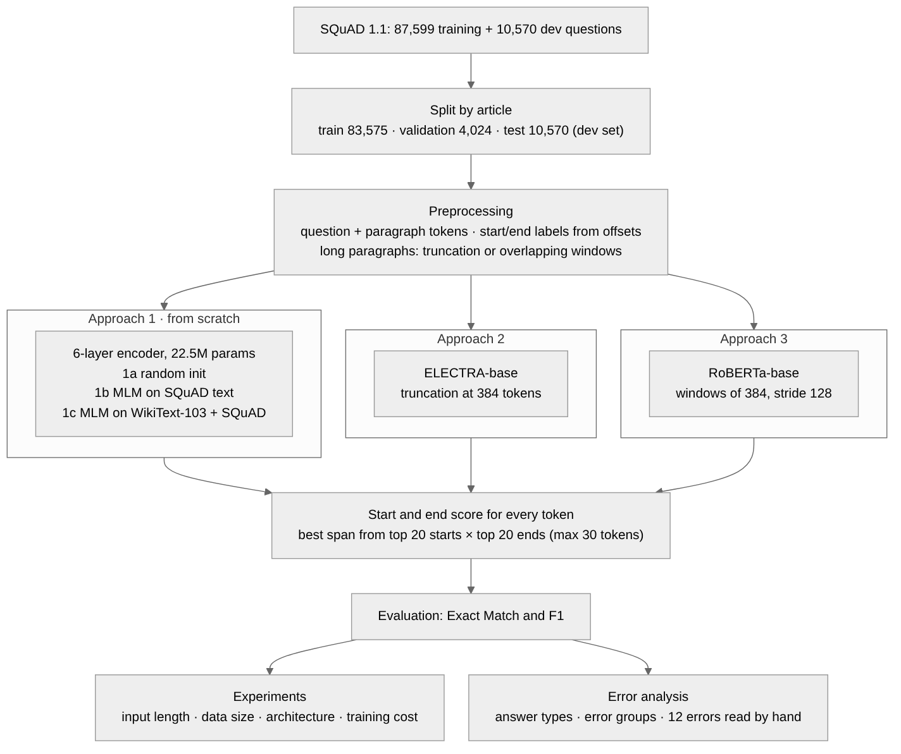
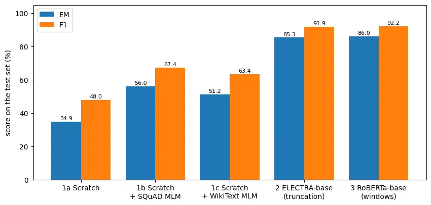

# Extractive Question Answering on SQuAD 1.1

Given a paragraph and a question, the model returns the part of the paragraph that answers the question, by predicting the start and end token of the answer. We compare three approaches on SQuAD 1.1:

1. A small Transformer encoder trained from scratch (no pretrained weights): 1a with random initialization, 1b pretrained with masked language modelling (MLM) on the SQuAD training text, and 1c pretrained with MLM on WikiText-103 plus the SQuAD paragraphs.
2. ELECTRA-base, fine-tuned, input cut at 384 tokens.
3. RoBERTa-base, fine-tuned, with overlapping windows for long paragraphs.

Example: for the paragraph "Alan Turing was a British mathematician and computer scientist. He introduced the concept of the Turing machine in 1936." and the question "In which year did Alan Turing introduce the Turing machine?" all five models answer 1936.



## Results

Test = official SQuAD 1.1 dev set (10,570 questions). Validation = 22 articles held out from the training set.

| Model | Params | Val EM | Val F1 | Test EM | Test F1 | Training time (T4) |
|---|---|---|---|---|---|---|
| 1a Scratch | 22.5M | 31.04 | 45.96 | 34.90 | 47.97 | 66 min |
| 1b Scratch + SQuAD MLM | 22.5M | 48.96 | 63.97 | 55.98 | 67.37 | 129 min |
| 1c Scratch + WikiText MLM | 22.5M | 45.53 | 60.18 | 51.17 | 63.41 | 142 min |
| 2 ELECTRA-base | 108.9M | 71.94 | **85.41** | 85.33 | 91.89 | 50 min |
| 3 RoBERTa-base | 124.1M | **72.04** | 85.23 | **86.04** | **92.16** | 49 min |



What we found:

* Pretraining matters most. ELECTRA and RoBERTa are about 44 test F1 better than the scratch model without pretraining. MLM pretraining of the scratch model adds 19.4 F1 with the SQuAD text (1b) and 15.4 F1 with WikiText-103 (1c).
* 1c ended 4 F1 behind 1b: its pretraining stopped while it was still improving, and 1b had already seen SQuAD's own questions and paragraphs.
* ELECTRA and RoBERTa are practically tied (within 0.3 F1).
* Cutting the input to 128 tokens loses about 20% of the answers and costs 14 to 15 F1. With windows almost no answer is lost and F1 comes back to about 83.
* With one epoch, ELECTRA reaches 76.8 / 81.1 / 83.6 / 85.2 validation F1 with 10 / 25 / 50 / 100% of the training data.
* About 72% of ELECTRA's wrong answers are boundary errors: the right place in the paragraph, but a word too many or too few.

## Files

```
squad_qa_colab.ipynb   the notebook: data, models, training, experiments, error analysis
inference.py           loads a trained model and answers a question
results/               result tables (CSV and JSON)
figures/               all plots
```

The trained models are in the Hugging Face repository [ummeabiha/squad-eqa-runs](https://huggingface.co/ummeabiha/squad-eqa-runs) under `models/`:

| Model | Folder |
|---|---|
| 1a Scratch | `scratch_f9ed439f` |
| 1b Scratch + SQuAD MLM | `scratch_mlm_d5ed7f75` |
| 1c Scratch + WikiText MLM | `scratch_wiki_mlm` |
| 2 ELECTRA-base | `electra_56b9af30` |
| 3 RoBERTa-base | `roberta_26dc0834` |

## Running the notebook

1. Open `squad_qa_colab.ipynb` in Google Colab and choose a T4 GPU (Runtime > Change runtime type).
2. Add a Hugging Face token with write access as a Colab secret called `HF_TOKEN` (key icon on the left).
3. Run all cells. Models, checkpoints, tables and figures are stored in the Hugging Face repository. A model that is already there is downloaded instead of trained again, and an unfinished training run continues from its last checkpoint.

## Using a trained model

Download a model folder from the repository, then:

```bash
pip install torch transformers
python inference.py --model-dir models/electra_56b9af30 \
    --question "In which year did Alan Turing introduce the Turing machine?" \
    --context "Alan Turing was a British mathematician and computer scientist. He introduced the concept of the Turing machine in 1936."
```

Long paragraphs are split into overlapping windows automatically. ELECTRA and RoBERTa also work with the Transformers pipeline:

```python
from transformers import pipeline
qa = pipeline("question-answering", model="models/electra_56b9af30", tokenizer="google/electra-base-discriminator")
qa(question="In which year did Alan Turing introduce the Turing machine?",
   context="Alan Turing was a British mathematician and computer scientist. He introduced the concept of the Turing machine in 1936.")
```

## Limitations

* Each model was trained once, so differences of a few tenths of a point are noise.
* Answer types and error groups come from simple rules and spaCy.
* The models differ in several ways at once, so the architecture comparison is not controlled.
* SQuAD 1.1 has no unanswerable questions, so the models always return some answer.

## References

* Rajpurkar et al. (2016). SQuAD: 100,000+ Questions for Machine Comprehension of Text.
* Clark et al. (2020). ELECTRA: Pre-training Text Encoders as Discriminators Rather Than Generators.
* Liu et al. (2019). RoBERTa: A Robustly Optimized BERT Pretraining Approach.
* Chen et al. (2017). Reading Wikipedia to Answer Open-Domain Questions.
* Merity et al. (2016). Pointer Sentinel Mixture Models (WikiText-103).

## Acknowledgements
- **AI assistance:** an AI assistant (Claude, Opus 5.5) was used to review and improve the code and documentation.
